<div align="center">


# Trail

### A long-lived desktop workspace for AI agents

**Projects, sessions, subagents, models, plugins and assets — in one desktop environment that keeps the work.**

Local-first · Model-agnostic · Plugin-powered · macOS / Windows / Linux

<br />

[](https://github.com/CharonZou/trail/releases/latest)
[](https://github.com/CharonZou/trail/releases)
[](https://github.com/CharonZou/trail/actions/workflows/ci.yml)
[](LICENSE)

<br />

**[Download](https://github.com/CharonZou/trail/releases/latest)** ·
[User guide](docs/guide/index.md) ·
[Plugin development](docs/plugin-development.md) ·
[Screenshots](docs/guide/screenshots.md) ·
[简体中文](README.zh-CN.md)

<br />

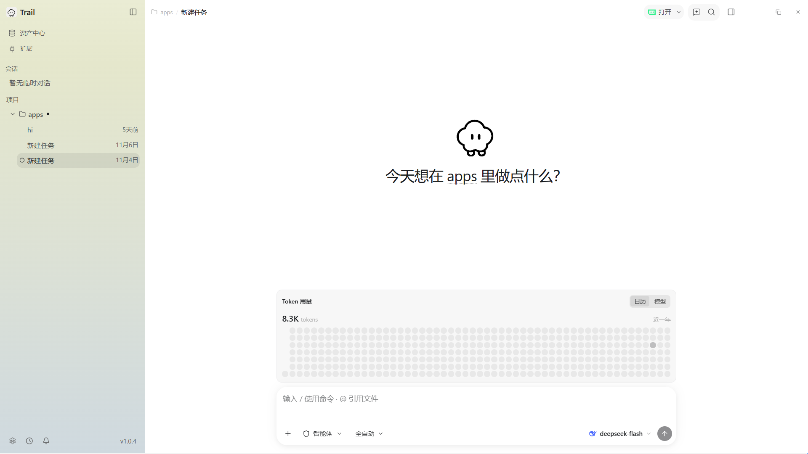

</div>

<sub>License: source-available under PolyForm Noncommercial 1.0.0 · free for personal, research and noncommercial use · **commercial use requires written authorization** · this is **not** an OSI open source license. See [License](#license).</sub>

---

## What Trail is

Most agent tools optimize for one turn: a terminal that executes, or an editor
panel that suggests. Trail is built for the work that continues — a project, the
sessions inside it, the agents working on them, the review and preview panels,
and the assets they accumulate, all in one long-lived desktop environment that
survives a restart.

Trail is a desktop application, not an IDE plugin and not a terminal front end.
Your projects, transcripts, settings and credentials stay on your machine in a
SQLite database owned by a Rust host core. Models are interchangeable: cloud
providers, local runtimes and OAuth-backed accounts join the same workflow.

> **Current release line: 1.0.5 (Early Preview).**

## Capabilities

* **Knowledge workbench (post-1.0.5).** A document no longer opens into a
  cramped preview. Libraries still sit behind a first-class sidebar destination,
  and the hub keeps reporting library, document and chunk totals with
  availability next to index health, access trend and recent activity — but
  opening a library now lands in a full three-pane workbench. The left pane is a
  file tree built from the imported source paths (folders start collapsed and
  open on click, with a heading outline one switch away); the center pane shows
  the stored body as Markdown under a hero summary with character, chunk and
  heading counts; the right rail keeps document health, metadata, index state,
  related documents and an activity trail visible while you read. Markdown and
  text documents are editable in place: saving writes the body back to the
  library, re-chunks it, clears stale vectors and records the change as
  `doc.save`. A search tab queries the library without leaving the document,
  offline full-text first and semantic search when configured, and agents still
  query a library through the built-in tool. Ask AI, Wiki and graph are
  declared as next phases rather than filled with placeholder data.
* **Knowledge base search and import (1.0.5).** Batch import of text, PDF and
  DOCX files, duplicates reported instead of stored twice, a per-library
  activity log, offline full-text search with a stated fallback reason, and a
  built-in tool agents can call to query any library.
* **Agent applications (1.0.5).** Register a web URL or a local folder and open
  it in the work-panel browser; each entry remembers when it was last opened,
  and a folder that loses its `index.html` stays listed as unavailable.
* **Same-history navigation (1.0.5).** A back/forward pair sits in the content
  titlebar on every destination and drives the same history stack as
  `Cmd/Ctrl+[` and `Cmd/Ctrl+]`, so pointer and keyboard always agree.
* **Asset center (1.0.4).** Overview, memory, skills and subagents collected in
  one workspace from a first-class sidebar entry: global and per-project asset
  counts, searchable memory entries, full skill and subagent management, and a
  versioned JSON backup of your own assets.
* **Conversation, Plan and Goal.** Interactive turns, a reviewable plan before
  execution, and a bounded long run with an explicit turn budget.
* **Subagents and parallel sessions.** Delegated work runs in its own session;
  parallel sessions are isolated in dedicated Git worktrees so concurrent tasks
  do not collide.
* **Configurable appearance (1.0.4).** Startup appearance, app icon style,
  chrome theme, whole-window versus floating-card layout, and the settings page
  surface are settings, not hardcoded design.
* **Plugins, not features.** Panels, tools, composer triggers, themes, floating
  widgets, background services and MCP servers ship as plugins with declared
  permissions and their own sandbox.
* **Permissions you control.** Filesystem, network, shell, browser, clipboard
  and credential access are gated per capability, and a plugin cannot talk its
  way past the gate.
* **Local-first storage.** Projects, transcripts, settings and secrets remain in
  a local SQLite database. Nothing is uploaded to make the app work.
* **Three platforms.** macOS, Windows and Linux ship the same local-first agent
  workflow.

## Screenshots

Every frame below is captured from a Trail preview build running on Windows
with the default Forest theme — no mockups.

| Knowledge base | Knowledge workbench |
| --- | --- |
| 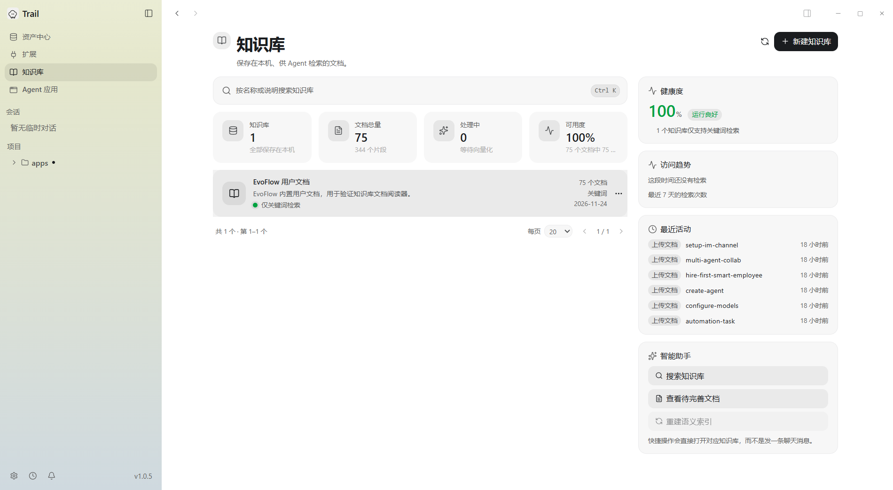 | 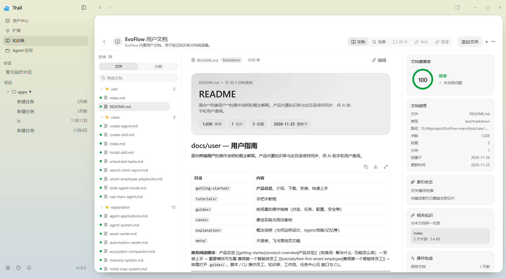 |
| **Agent applications** | **Titlebar history** |
| 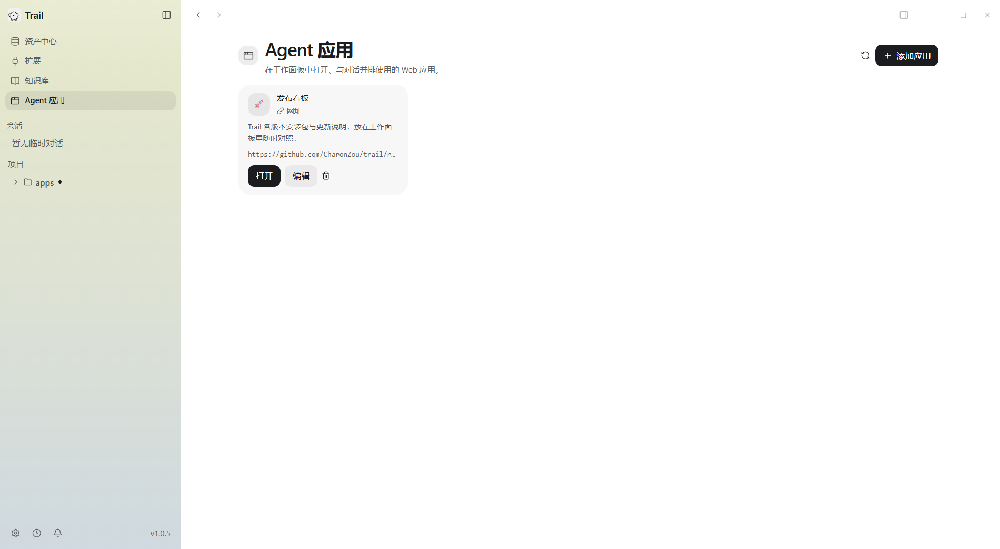 | 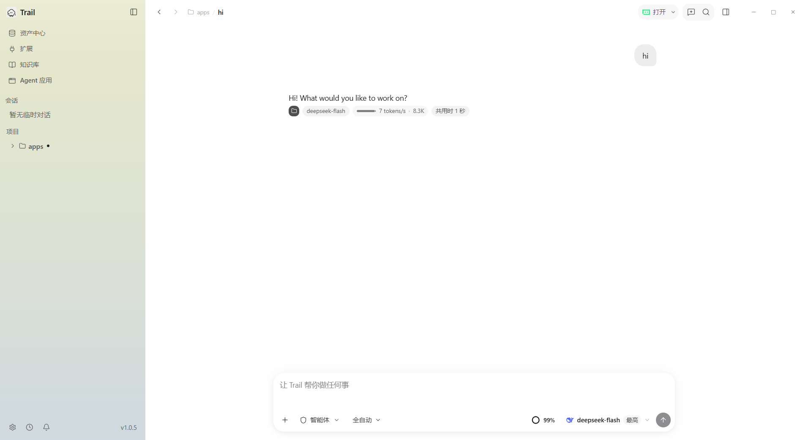 |
| **Asset center** | **Skills** |
| 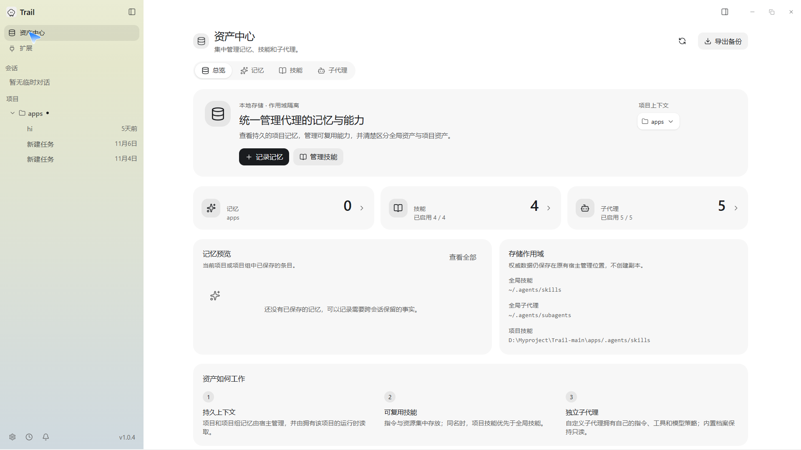 | 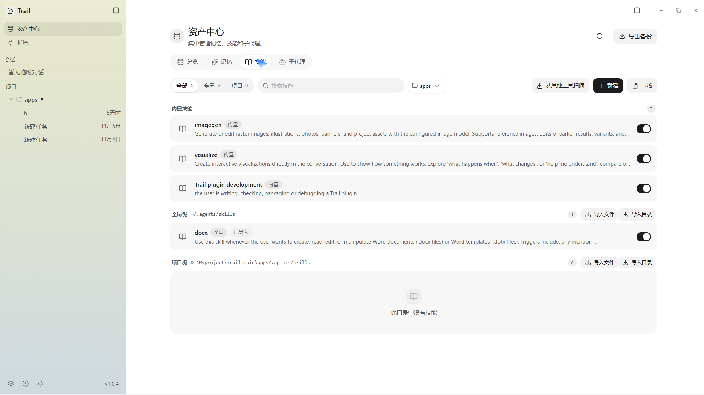 |
| **Subagents** | **Memory** |
| 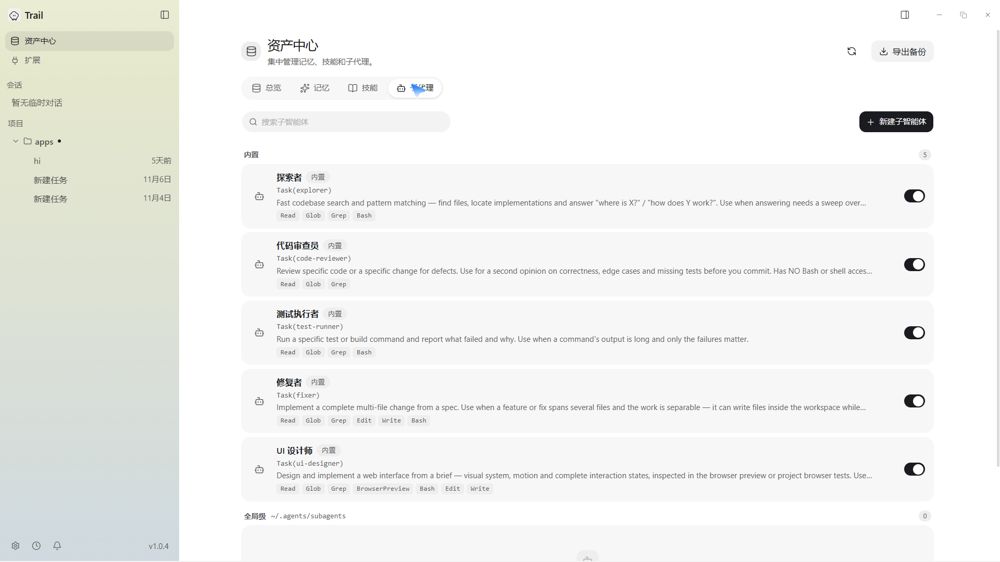 | 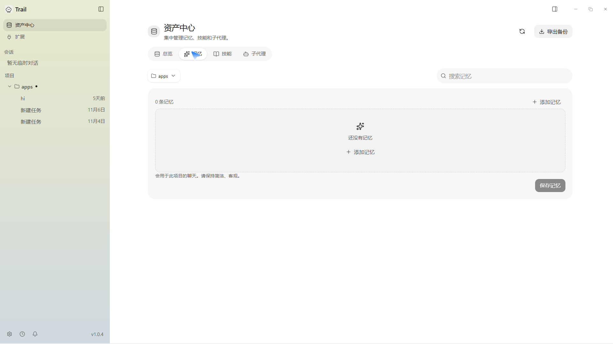 |
| **Extensions** | **Appearance** |
| 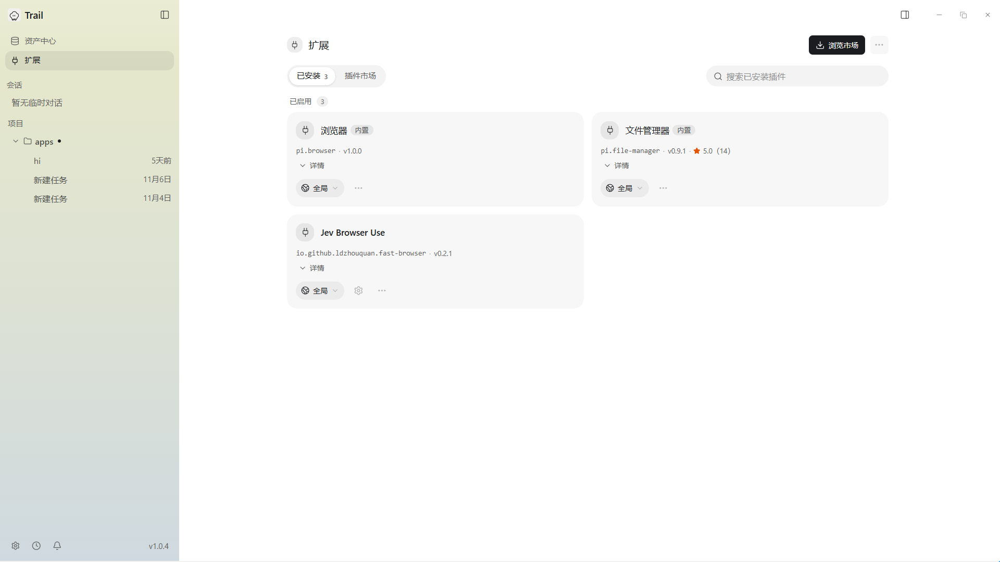 | 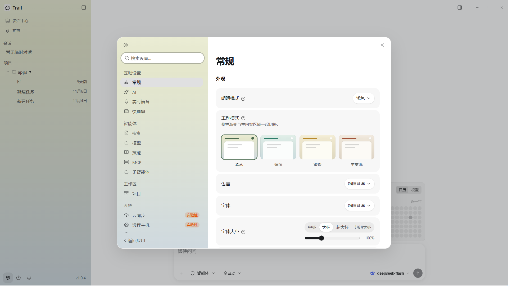 |

Theme, layout, language and typography are settings, not design.

## Quick start

### Desktop build

1. Download the package for your platform from the
   [releases page](https://github.com/CharonZou/trail/releases/latest):
   Windows installer or portable ZIP, macOS DMG / ZIP for Apple Silicon and
   Intel, and AppImage / deb / rpm for Linux.
2. Open Trail, then add a provider and API key under **Settings → Models**,
   test the connection, and set it as the main model.
3. Start a conversation. Use **Plan** for work that deserves a review step and
   **Goal** for a bounded long run.

macOS builds are not Apple-notarized yet. If the app reports that it is damaged
or cannot be verified, either run

```bash
xattr -cr /Applications/Trail.app
```

or allow it under **System Settings → Privacy & Security → Open Anyway**.

### From source

Requirements: Node.js `>=22.19`, pnpm `>=10`, and a stable Rust toolchain.

```bash
git clone https://github.com/CharonZou/trail.git
cd trail

pnpm install

cargo build -p host-core
pnpm build:js

pnpm dev
```

Verification:

```bash
pnpm typecheck
pnpm lint
pnpm test
cargo test -p host-core
```

Packaged builds need the release host binary and the runtime bundle:

```bash
pnpm dist
```

On Windows, `start-dev.cmd` performs the same startup steps in one click.

## Latest release: 1.0.5

Released 2026-11-24. 1.0.5 continues the 1.0.x early-preview line; the version
log in **Settings → About** lists 1.0.1 through 1.0.5 in detail, and earlier
history is intentionally omitted.

| Version | Highlights |
| --- | --- |
| **1.0.5** | Knowledge base (hub, searchable libraries, batch import, in-app document reader, offline full-text and optional semantic search, agent tool), Agent applications opened in the work-panel browser, titlebar back/forward, Fast mode, prompt-cache-stable runtime rebuilds, Chinese IME slash fix, regenerated-prompt ordering, faster inline visualizations |
| **1.0.4** | Asset center (overview, memory, skills, subagents, JSON backup), configurable startup appearance, app icon and chrome theme, Trail data-directory adoption for existing installs |
| **1.0.3** | Whole-window versus floating-card layout, settings page as a sheet, thinking-effort slider with `Ctrl+T`, provider brand marks, open a project in VS Code / Trae / IntelliJ IDEA |
| **1.0.2** | Per-project workspace icon and color, workspace index toggle, token usage card, window card, more provider marks |
| **1.0.1** | Initial release: local-first workspace, model freedom, persistent transcripts, parallel worktree sessions, subagents, plugins, three platforms |

### Next: knowledge workbench

The document page is being rebuilt from a library detail list into a workbench,
in phases. Phase 1 is implemented and in review; it is not part of a release
yet.

* **Three panes, one surface.** Collapsible file tree and heading outline on
  the left, the document beside it, and a rail of health, metadata, index state,
  related documents and activity that stays visible while you read.
* **A real reader.** The stored body renders as Markdown under a hero summary
  with character, chunk and heading counts, anchored headings, and copy /
  download actions, instead of a truncated preview.
* **Editable bodies.** Markdown and text documents save back into the library:
  the body is re-chunked, stale vectors are cleared, and the change is recorded
  as a `doc.save` activity.
* **Honest health.** The rail's score is computed from real deductions — missing
  body, failed or pending indexing, no headings, stale update — never a
  hardcoded number.
* **Search stays in context.** A search tab answers library-scoped queries
  beside the open document. Ask AI, Wiki and graph are declared as next phases
  rather than filled with placeholder data.

Later phases add cited answers (Ask AI), deterministic wiki pages and a
document graph.

## Repository layout

| Path | Responsibility |
| --- | --- |
| `apps/desktop` | Renderer, preload and Electron main process |
| `apps/pi-host` | Remote host build used over SSH |
| `crates/host-core` | Rust host: persistence, files, plugins, credentials |
| `packages/agent-runtime` | Agent execution on top of pi |
| `packages/shared` | Cross-boundary contracts and schemas |
| `packages/plugin-sdk` | Plugin authoring contract |
| `docs/` | Specs, ADRs, user guide |

## Documentation

* [User guide](docs/guide/index.md) and [screenshots](docs/guide/screenshots.md)
* [Architecture](docs/spec/02-architecture/01-architecture.md) and
  [specifications](docs/spec/README.md)
* [Decision records](docs/adr/README.md)
* [Plugin development](docs/plugin-development.md)
* [E2E test plan](docs/spec/06-delivery/04-e2e-test-plan.md) and
  [release runbook](docs/spec/06-delivery/06-release-runbook.md)
* [Agent development policy](AGENTS.md)

## Contributing

Issues, pull requests, plugins, skills, MCP integrations, documentation and
translations are all welcome. Before writing code, read [`AGENTS.md`](AGENTS.md)
and [`CONTRIBUTING.md`](CONTRIBUTING.md): they define the boundaries a change
may not cross.

For a capability that is only yours, ask one question first: **would this be
better as a plugin?** Keep the core restrained and let the ecosystem grow.

Report security vulnerabilities privately as described in
[`SECURITY.md`](SECURITY.md), not through a public issue.

## Support the project

If Trail helps you, you are welcome to support its continued development.
Support is voluntary and does not affect your rights under the license; it is
not a commercial license, and it does not buy priority support.

<p align="center">

<br />
<sub>WeChat scan to support</sub>
</p>

Commercial cooperation, custom development and licensing: **2085723867@qq.com**

## License

Copyright (C) 2026 CharonZou.

Trail is released under the **PolyForm Noncommercial License 1.0.0**
([`LICENSE`](LICENSE)): the source is available, personal study, research and
other noncommercial use is free, and **commercial use requires prior written
authorization** from the copyright holder (2085723867@qq.com). It is a
source-available license, **not** an OSI-approved open source license.

Upstream and bundled components keep their own licenses; the full statement is
in [`NOTICE`](NOTICE). That includes the MIT-licensed pi agent engine and the
LGPL-3.0-licensed desktop shell this project grew from.

## Acknowledgements

Trail's development was inspired by and builds on several projects. The agent
loop, provider access and coding tools come from
[`earendil-works/pi`](https://github.com/earendil-works/pi) (MIT). The early
desktop workbench, Rust host core, plugin system and specification set grew from
[`vastsa/PI-Desktop`](https://github.com/vastsa/PI-Desktop) (LGPL-3.0). The
bundled file manager is vendored from its MIT-licensed upstream. Design ideas
were also informed by open agent workspaces, MCP, Electron and the Rust
ecosystem. See [`NOTICE`](NOTICE) for the complete attribution.

## Contact

* [GitHub Issues](https://github.com/CharonZou/trail/issues) and
  [Discussions](https://github.com/CharonZou/trail/discussions)
* **2085723867@qq.com**

<p align="center">

<br />
<sub>WeChat scan to add the author</sub>
</p>

---

<div align="center">


### Build your own agent workspace.

**Your model · Your agent · Your plugins · Your workspace**

<br />

**[Download](https://github.com/CharonZou/trail/releases/latest)** ·
[User guide](docs/guide/index.md) ·
[Build a plugin](docs/plugin-development.md)

<br /><br />

<sub>Local-first · Model-agnostic · Plugin-powered</sub>

</div>
