<div align="center">


# Trail

### 长期可用的 AI Agent 桌面工作台

**把项目、会话、子智能体、模型、插件和资产，装进一个能留住工作的桌面环境。**

本地优先 · 模型自由 · 插件驱动 · macOS / Windows / Linux

<br />

[](https://github.com/CharonZou/trail/releases/latest)
[](https://github.com/CharonZou/trail/releases)
[](https://github.com/CharonZou/trail/actions/workflows/ci.yml)
[](LICENSE)

<br />

**[立即下载](https://github.com/CharonZou/trail/releases/latest)** ·
[使用文档](docs/guide/index.md) ·
[插件开发](docs/plugin-development.md) ·
[界面预览](docs/guide/screenshots.md) ·
[English](README.md)

<br />

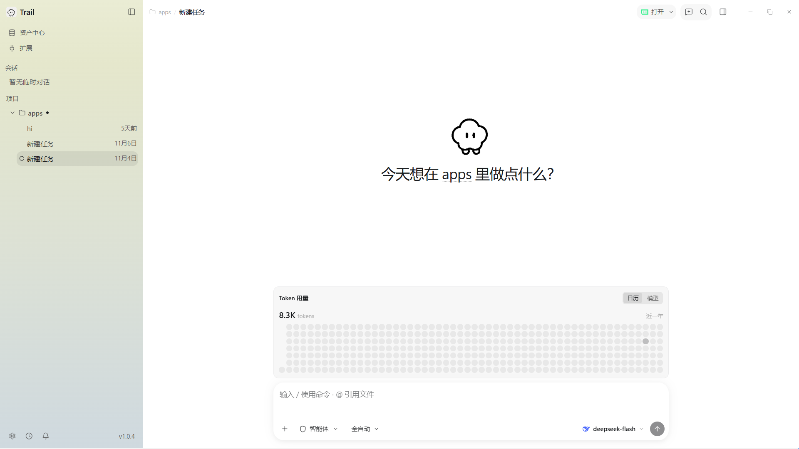

</div>

<sub>许可：源码可见（PolyForm Noncommercial 1.0.0）· 个人、研究与非商业使用免费 · **商业使用须书面授权** · **不是** OSI 开源许可证。详见[授权](#授权)。</sub>

---

## 简介

多数 Agent 工具只优化一轮对话：终端负责执行，编辑器侧栏负责补全。
Trail 面向的是会继续下去的工作——一个项目、项目里的会话、正在处理它的 Agent、
审阅与预览面板，以及它们沉淀下来的资产，全部放在同一个长期可用的桌面环境里，
重启之后仍然在。

Trail 是独立桌面应用，不是 IDE 插件，也不是终端前端。项目、转录、设置与凭据
保存在你自己电脑上的 SQLite 数据库里，由 Rust host core 管理。模型可以随时更换：
云端服务商、本地运行时和订阅账户（OAuth）都能进入同一套工作流。

> **当前发布线：1.0.5（早期预览）。**

## 能力

* **知识库（1.0.5）**：侧栏一级入口。总览页给出知识库、文档与片段数量及可用度，
  旁边汇总健康度、访问趋势与最近活动；每个库可打开为可搜索的文档列表，
  支持文本、PDF、DOCX 批量导入（重复内容明确标记而不重复占用），点开文档即可
  在同一窗口以 Markdown 阅读已入库内容。搜索基于本地全文索引、离线可用，
  语义检索为可选项，未配置向量服务时按关键词返回并说明原因；智能体可通过内置工具检索知识库。
* **Agent 应用（1.0.5）**：登记网址或本地文件夹，在工作面板浏览器中打开，
  记录最近打开时间；文件夹缺少 `index.html` 时仍列出但标记不可用。
* **同一历史栈的前进后退（1.0.5）**：内容区标题栏在每个页面都提供一对
  「后退 / 前进」，与 `Cmd/Ctrl+[`、`Cmd/Ctrl+]` 读同一个历史栈，指针与键盘结果一致。
* **资产中心（1.0.4）**：侧栏一级入口，把总览、记忆、技能与子智能体收进同一个工作台；
  区分全局与项目作用域，记忆可搜索编辑，技能与子智能体可完整管理，
  并能导出版本化 JSON 备份。
* **对话 / Plan / Goal**：日常协作；先出可修订计划再执行；长任务按明确的回合预算运行。
* **子智能体与并行会话**：委派任务在自己的会话里执行；并行会话隔离在独立 Git worktree，
  避免并发任务互相覆盖。
* **外观可配置（1.0.4）**：启动外观、应用图标样式、窗口主题、整窗或浮卡排版、
  设置页呈现方式都是设置项，而不是写死的设计。
* **插件，而不是堆功能**：面板、工具、输入框触发器、主题、浮窗、后台服务与 MCP 服务
  都以插件形式接入，权限需声明，插件有自己的沙箱。
* **权限由你控制**：文件、网络、Shell、浏览器、剪贴板与凭据访问按能力授权，
  插件无法绕过这道闸门。
* **本地优先**：项目、转录、设置与密钥留在本地 SQLite 数据库里，
  应用运行不依赖上传任何数据。
* **三平台一致**：macOS、Windows 与 Linux 提供同一套本地优先 Agent 工作流。

## 界面

以下截图来自 Windows 上运行的 Trail 预览版，默认「森林」主题，不是效果图。

| 知识库 · 总览 | 文档阅读器 |
| --- | --- |
| 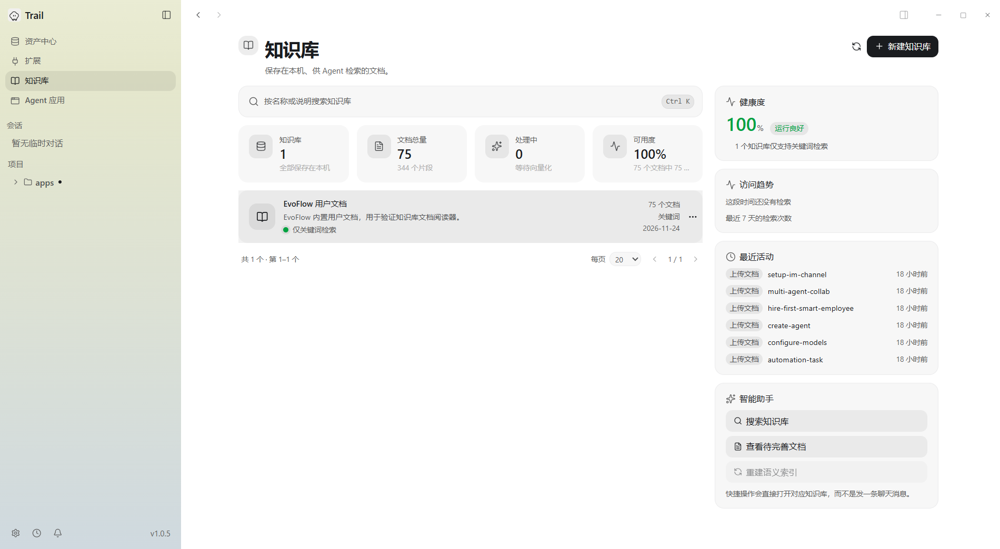 | 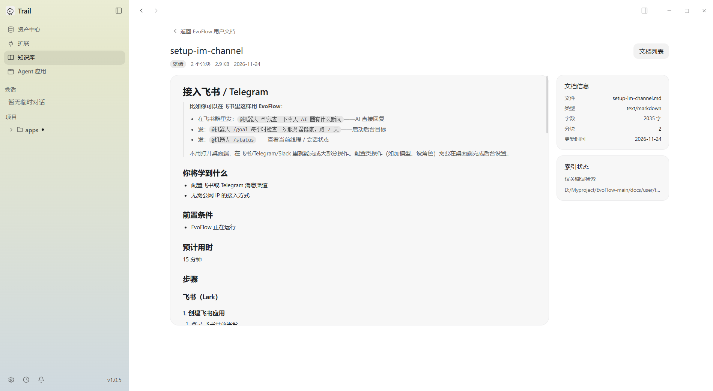 |
| **Agent 应用** | **标题栏前进后退** |
| 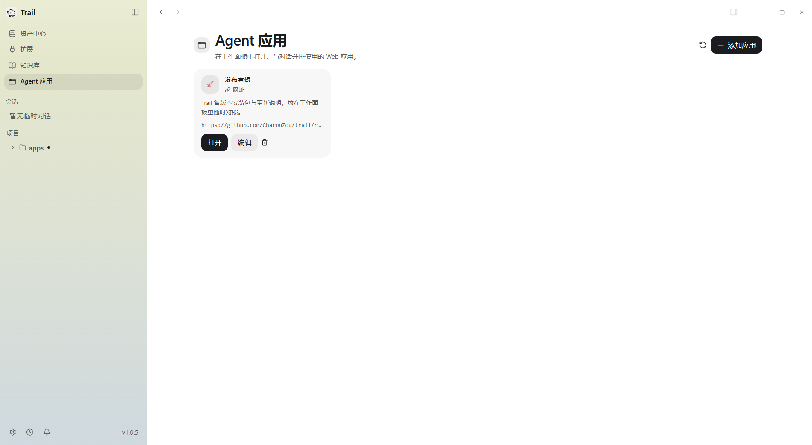 | 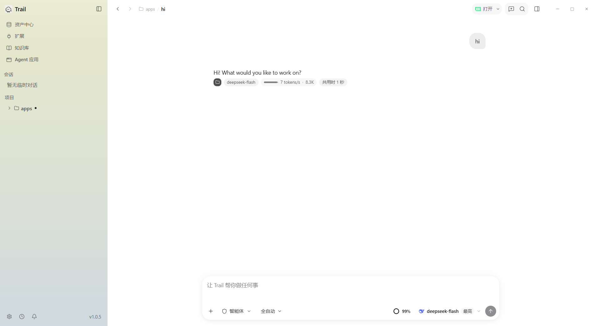 |
| **资产中心 · 总览** | **资产中心 · 技能** |
| 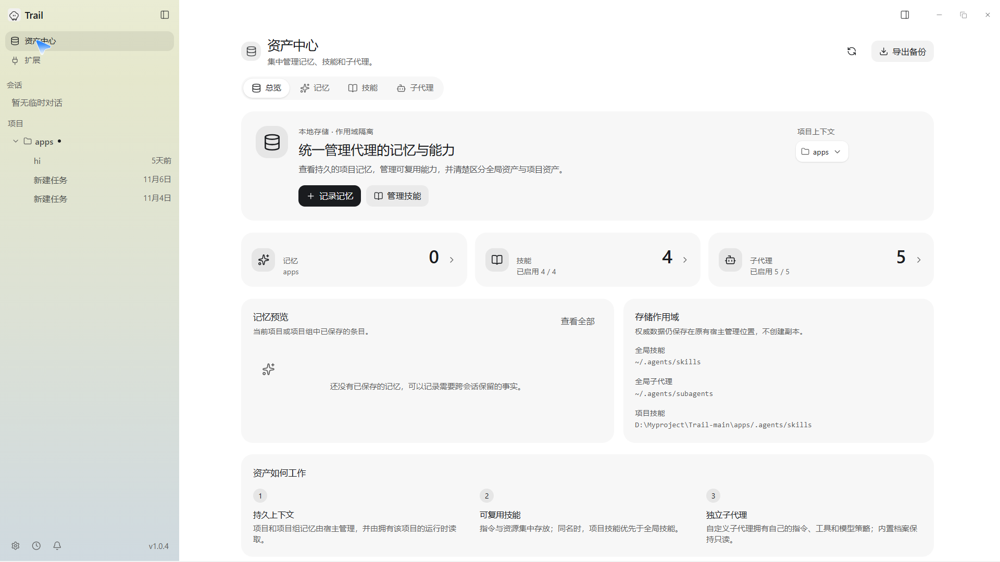 | 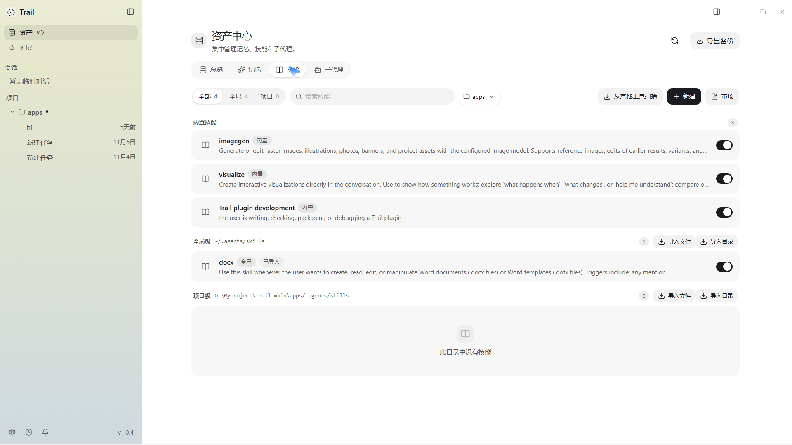 |
| **资产中心 · 子智能体** | **资产中心 · 记忆** |
| 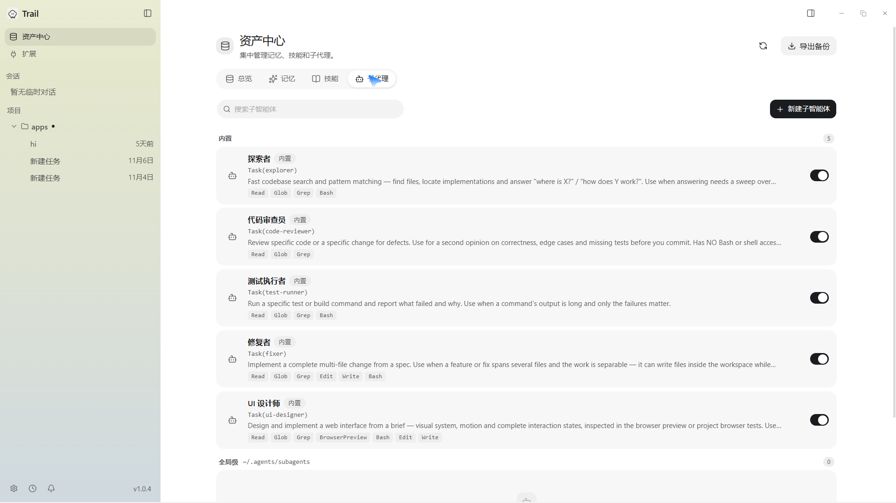 | 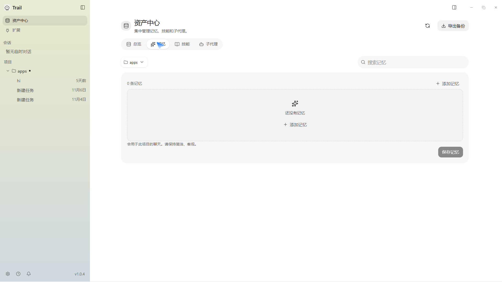 |
| **扩展** | **外观设置** |
| 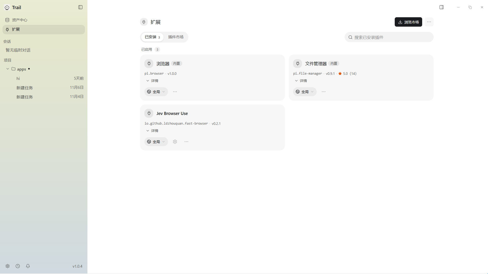 | 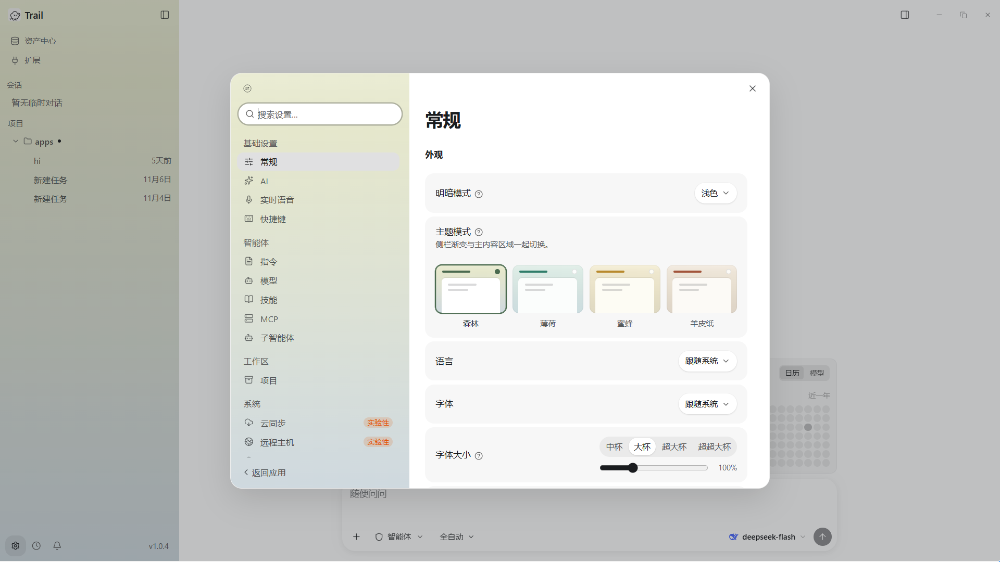 |

主题、排版、语言与字号都是设置项，而不是写死的设计。

## 快速开始

### 桌面安装包

1. 从 [Releases](https://github.com/CharonZou/trail/releases/latest) 下载对应平台的包：
   Windows 安装程序或便携版 ZIP，macOS 的 DMG / ZIP（Apple Silicon 与 Intel），
   以及 Linux 的 AppImage / deb / rpm。
2. 打开 Trail，在 **设置 → 模型** 添加服务商与 API Key，测试连接后设为主模型。
3. 开始对话。需要先审阅的工作用 **Plan**，有边界的长期任务用 **Goal**。

macOS 版本尚未做 Apple 公证。若提示「已损坏」或无法验证，可以执行

```bash
xattr -cr /Applications/Trail.app
```

或在 **系统设置 → 隐私与安全性 → 仍要打开** 中放行。

### 从源码运行

依赖：Node.js `>=22.19`、pnpm `>=10`、稳定的 Rust 工具链。

```bash
git clone https://github.com/CharonZou/trail.git
cd trail

pnpm install

cargo build -p host-core
pnpm build:js

pnpm dev
```

验证：

```bash
pnpm typecheck
pnpm lint
pnpm test
cargo test -p host-core
```

打包需要 release 版 host 二进制与运行时 bundle：

```bash
pnpm dist
```

Windows 上可直接双击 `start-dev.cmd` 完成同样的启动步骤。

## 最新发布：1.0.5

发布于 2026-11-24。1.0.5 延续 1.0.x 早期预览线；**设置 → 关于**里的版本日志只保留
1.0.1 至 1.0.5 的详细介绍，更早的历史已移除。

| 版本 | 主要改进 |
| --- | --- |
| **1.0.5** | 知识库（总览、可搜索的库、批量导入、应用内文档阅读器、离线全文与可选语义检索、智能体检索工具）、Agent 应用在工作面板浏览器打开、标题栏前进后退、Fast 模式、运行时重建保留提示词缓存、中文输入法斜杠修复、重新生成消息排序、内联可视化提速 |
| **1.0.4** | 资产中心（总览、记忆、技能、子智能体、JSON 备份）、启动外观 / 应用图标 / 窗口主题可配置、已有安装沿用 Trail 数据目录 |
| **1.0.3** | 整窗与浮卡排版、设置页浮层、思考强度滑块与 `Ctrl+T`、服务商品牌标识、用 VS Code / Trae / IntelliJ IDEA 打开项目 |
| **1.0.2** | 项目工作区图标与颜色、工作区索引开关、Token 用量卡、窗口卡片、更多服务商标识 |
| **1.0.1** | 初始版本：本地优先工作台、模型自由、持久转录、并行 worktree 会话、子智能体、插件、三平台 |

## 仓库结构

| 路径 | 职责 |
| --- | --- |
| `apps/desktop` | 渲染进程、preload 与 Electron 主进程 |
| `apps/pi-host` | 通过 SSH 使用的远程 host 构建 |
| `crates/host-core` | Rust host：持久化、文件、插件、凭据 |
| `packages/agent-runtime` | 基于 pi 的 Agent 执行 |
| `packages/shared` | 跨边界契约与 schema |
| `packages/plugin-sdk` | 插件开发契约 |
| `docs/` | 规格、ADR、用户文档 |

## 文档

* [使用文档](docs/guide/index.md) 与 [界面预览](docs/guide/screenshots.md)
* [架构](docs/spec/02-architecture/01-architecture.md) 与
  [规格](docs/spec/README.md)
* [决策记录](docs/adr/README.md)
* [插件开发](docs/plugin-development.md)
* [E2E 测试计划](docs/spec/06-delivery/04-e2e-test-plan.md) 与
  [发布手册](docs/spec/06-delivery/06-release-runbook.md)
* [Agent 开发策略](AGENTS.md)

## 参与贡献

欢迎缺陷报告、PR、插件、技能、MCP 集成、文档与翻译。写代码之前请先读
[`AGENTS.md`](AGENTS.md) 与 [`CONTRIBUTING.md`](CONTRIBUTING.md)——它们定义了不能越过的边界。

如果某项能力只属于你，先问一个问题：**它做成插件会不会更好？**
让核心保持克制，让生态自己生长。

安全问题请按 [`SECURITY.md`](SECURITY.md) 私下报告，不要发公开 Issue。

## 支持项目

如果 Trail 对你有帮助，欢迎支持项目的持续开发。
支持完全自愿，不影响你在许可证下的权利，也不构成商业许可或优先支持承诺。

<p align="center">

<br />
<sub>微信扫码支持</sub>
</p>

商业合作、定制开发与授权：**2085723867@qq.com**

## 授权

版权所有 © 2026 CharonZou。

Trail 以 **PolyForm Noncommercial License 1.0.0**（[`LICENSE`](LICENSE)）发布：
源码可见，个人学习、研究与其他非商业用途免费，**商业使用须事先取得版权持有人的
书面授权**（2085723867@qq.com）。这是源码可见许可证，**不是** OSI 认定的开源许可证。

上游与内置组件保留各自的许可证，完整声明见 [`NOTICE`](NOTICE)，
包括 MIT 协议的 pi Agent 引擎，以及本项目早期所基于的 LGPL-3.0 桌面外壳。

## 致谢

Trail 的开发参考并建立在多个项目之上。Agent 循环、服务商接入与编码工具来自
[`earendil-works/pi`](https://github.com/earendil-works/pi)（MIT）；
早期桌面工作台、Rust host core、插件体系与规格文档源于
[`vastsa/PI-Desktop`](https://github.com/vastsa/PI-Desktop)（LGPL-3.0）；
内置文件管理器来自其 MIT 协议的上游。设计思路也参考了开源 Agent 工作台、
MCP、Electron 与 Rust 生态。完整归属见 [`NOTICE`](NOTICE)。

## 联系

* [GitHub Issues](https://github.com/CharonZou/trail/issues) 与
  [Discussions](https://github.com/CharonZou/trail/discussions)
* **2085723867@qq.com**

<p align="center">

<br />
<sub>微信扫码添加作者</sub>
</p>

---

<div align="center">


### 组装你自己的 Agent 工作台。

**你的模型 · 你的 Agent · 你的插件 · 你的工作区**

<br />

**[立即下载](https://github.com/CharonZou/trail/releases/latest)** ·
[使用文档](docs/guide/index.md) ·
[开发插件](docs/plugin-development.md)

<br /><br />

<sub>本地优先 · 模型自由 · 插件驱动</sub>

</div>
